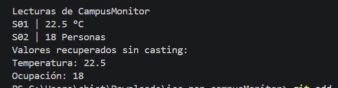

Describe brevemente:

>Qué representa la clase Lectura<T>.
Para mi lo que representa la clase lectura es una clase generica que tiene tiene tres atributos con su respectivo constructor y guetters los cuales nos vvan a ayudar en el app para poder extraer datos sin necesidad de hacerlo todo en el app.
> Qué representa T y por qué permite utilizar la misma clase para temperatura y ocupación.
Permite utilizar ambas porque dentro de la clase generica tipo T ya que adentro de esta clase nos va a permitir usar los atributos que tiene dicha clase generica 
> Qué agregaste en App.java.
En el app primero le mande unos datos que se van almacenar en la clase generica y despues imprimirlos unos a uno con los souts y los .getValor. y demas 

## Captura
