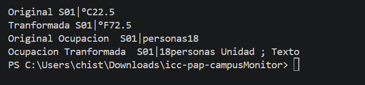

### 1. Implementación realizada

*En un párrafo breve, explica qué representa R y por qué transformar es genérico aunque runTransformaciones no lo sea. Indica qué agregaste en Lectura y App.*

En el app antes q hacer todos los souts conservamos los anteriores valores dados ya q para este ejercicio si sirve ademas le hicimso una nueva variable de farenheit que tenia por dentro su respectiva transformacion y su  grado farenheid ademas de crear ocupaciones de texto de lo cual hace que pasemos de numeros a texto y nos lo mostrara en la impresion ademas los acompañamos de los souts con cada dato que ya teniamos utilizando los geterrs de la clase generica .En la clase lectura creamos un metodo generico en el cual validmos dos veces una vez para ver que el primer valor ingresado no sea nulo y a su vez guaradr dicho numero en una varible de tipo texto para despues validar de nuevo y en cada proceso de validacion añadimos una excepcion por si el valor ingresado vaya a ser nulo y por ultimo si pasa la validacion mandamos lso mismos codigos el mismo valro y demas .

## 2. Ejecución correcta

*Agrega una captura que muestre ambas transformaciones y sus valores originales, y otra con los mensajes de los tres casos inválidos. Debajo, explica en una o dos frases cómo comprobaste que el original se conserva y que el resultado puede tener otro tipo.*

Pudimos comrabar ya que agregamos en una variablestring  el valor de la ocupacion texto que estara sin hacer casting y de ahi la imprimiremos en la salida final esperada para asi poder ver si cambia y comprobar si el resultado puede tener otro tipo.